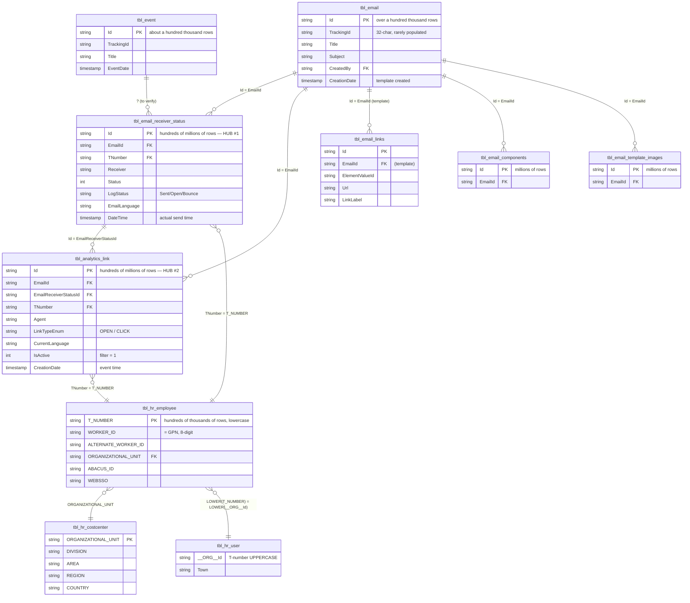

# ER Diagram — `imep_bronze.*`

> Extended version of Section 2 of [architecture_diagram.md](../architecture_diagram.md). Shows the full Bronze topology for iMEP with every join key, order-of-magnitude row count, and cross-link to HR.

---

## Full Bronze topology

---

## Volumes & Write Patterns

| Table | Rows | Pattern |
|---|---|---|
| `tbl_email_receiver_status` | **Hundreds of millions** | MERGE full-table upsert (tens of millions/run) |
| `tbl_analytics_link` | **Hundreds of millions** | MERGE **incremental** (thousands/run) |
| `tbl_email` | Over a hundred thousand | MERGE full-table upsert |
| `tbl_hr_employee` | Hundreds of thousands | MERGE full-table upsert |
| `tbl_email_components` | Millions | MERGE |
| `tbl_email_template_images` | Millions | MERGE |
| `tbl_event` | About a hundred thousand | MERGE |

---

## Three join types in this domain

### 1. Mailing-centric (starts from `tbl_email`)

For "what happened to mailing X?". See [imep_bronze_email_events.md](../joins/imep_bronze_email_events.md).

### 2. Person-centric (starts from `tbl_hr_employee`)

For "which engagement events did person X have?". Only possible via the two hub tables `tbl_email_receiver_status` and `tbl_analytics_link` — **the SharePoint side has no equivalent person key**.

### 3. HR enrichment (from any TNumber-bearing table)

For "enrich my engagement fact with Region/Division". See [hr_enrichment.md](../joins/hr_enrichment.md).

---

## Key observations

- **Two full-key hubs**: only `tbl_email_receiver_status` and `tbl_analytics_link` carry `Id + EmailId + TNumber` simultaneously. These are the only tables with **person-level engagement granularity**.
- **`TrackingId` scope**: in Bronze only on `tbl_email` and `tbl_event`. **Never** on engagement tables. If you need a TrackingId in a join, you have to bring it in via `tbl_email.Id = EmailId`.
- **`tbl_email_links` vs. `tbl_analytics_link`**: do not confuse them. `tbl_email_links` is the template URL inventory (static); `tbl_analytics_link` is the event fact table (Open/Click).
- **HR link order**: engagement table → `tbl_hr_employee` → `tbl_hr_costcenter` (via `ORGANIZATIONAL_UNIT`). `tbl_hr_user` offers additional fields (Town); not required for Region/Division.

---

## References

- [Section 2 in architecture_diagram.md](../architecture_diagram.md) — original version
- [Join Strategy Contract](../joins/join_strategy_contract.md)
- Card per table: [tbl_email](../tables/imep/tbl_email.md), [tbl_email_receiver_status](../tables/imep/tbl_email_receiver_status.md), [tbl_analytics_link](../tables/imep/tbl_analytics_link.md)

---

## Sources

Genie sessions backing the statements on this page: [Q27](../sources.md#q27), [Q30](../sources.md#q30). See [sources.md](../sources.md) for the full index.
