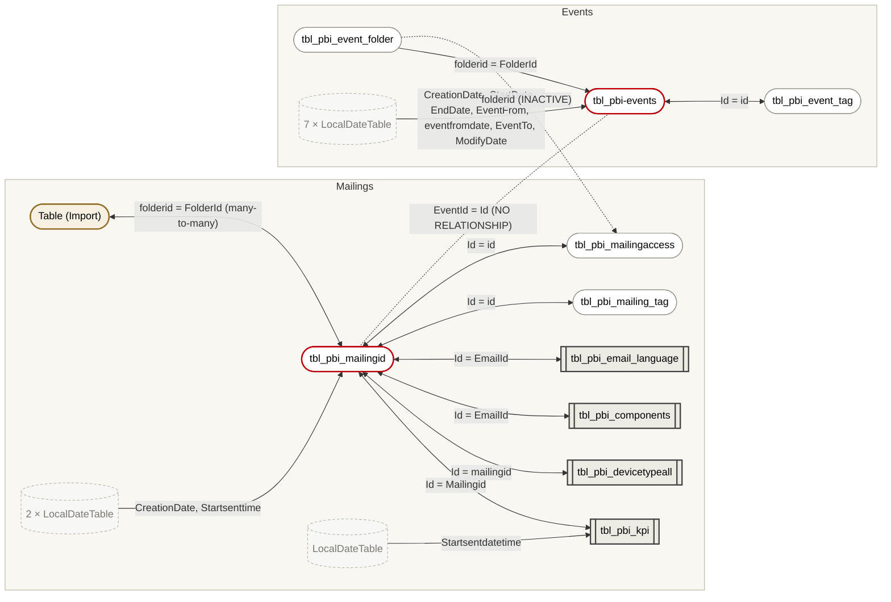
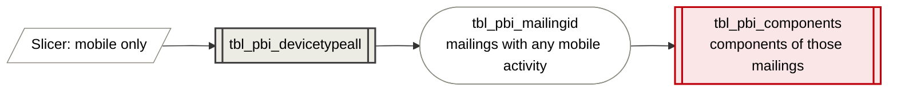

# iMEP Mailings

| | |
|---|---|
| Workspace | IMEP-UAT |
| Snapshot | 2026-10-16 |
| Source | `INFO.VIEW.*` metadata export (relationships, columns, measures, tables), photographed |
| Access | Read only — measure DAX and source queries are hidden, see [Open questions](#open-questions) |
| Storage | Composite: 10 tables DirectQuery, 1 table Import |

Object names that contain the organisation name are written as `__ORG__`, so the
repository stays free of it.

## Executive summary

iMEP Mailings reports on the iMEP mailing platform: how many mailings were sent, delivery,
open and click rates by device and language, which content components were used — and, in a
separate part, events and their registrations.

It has **21 tables (10 data tables, 1 small mapping table named `Table`, 10 hidden auto-date
tables), ~115 columns in the data tables, 33 measures and 20 relationships.** The data tables are read
**live (DirectQuery)**: nothing is stored in the model, every visual sends a query to the
source.

Structurally it is **two models in one**: *mailings* around `tbl_pbi_mailingid`, and
*events* around `tbl_pbi-events`. The only link between them is switched off, and the
obvious link (`tbl_pbi_mailingid[EventId]`) isn't there at all.

Main risks:

1. **No shared calendar.** Ten date columns each have their own hidden calendar, so mailings
   and events can't be put on one timeline with one slicer (issue 1).
2. **Both-way filters around `tbl_pbi_mailingid`, on live queries.** A filter on device type
   changes component and language figures too, and each both-way link makes the live
   queries heavier (issue 3).
3. **A self-built access filter.** An imported table `Table` (email → folder) is joined
   many-to-many to the mailings. It looks like "each user sees their own folders". That is
   not real security, and it goes stale between refreshes (issue 4).

**Recommended order:** one date table → decide whether mailings and events belong in one
model → single-direction filters → replace the `Table` mapping with proper row-level
security → tidy duplicate columns and measures.

## At a glance

| Role | Tables |
|---|---|
| Mailing hub | `tbl_pbi_mailingid` (one row per mailing) |
| Mailing facts | `tbl_pbi_kpi`, `tbl_pbi_devicetypeall`, `tbl_pbi_components`, `tbl_pbi_email_language` |
| Mailing lookups | `tbl_pbi_mailing_tag`, `tbl_pbi_mailingaccess`, `Table` (Import) |
| Events | `tbl_pbi-events` (one row per event), `tbl_pbi_event_tag`, `tbl_pbi_event_folder` |
| Hidden | 10 × `LocalDateTable_…` (auto date/time) |

## How the tables connect

Arrows show the direction a filter travels: from the table with one row per key to the
table with many. **Double-headed arrows filter both ways.** Dotted = inactive or missing.

**Legend:** grey boxes = fact tables · white = lookup tables · red outline = hub ·
beige = imported table in an otherwise live model · dashed = hidden auto-date tables.

### Relationships

| # | Many side (filtered) | One side (filters) | Key | Direction | Active |
|---|---|---|---|---|---|
| 1 | `Table` | `tbl_pbi_mailingid` | `folderid` ↔ `FolderId` | **both, many-to-many** | yes |
| 2 | `tbl_pbi_components` | `tbl_pbi_mailingid` | `EmailId` → `Id` | both | yes |
| 3 | `tbl_pbi_devicetypeall` | `tbl_pbi_mailingid` | `mailingid` → `Id` | both | yes |
| 4 | `tbl_pbi_email_language` | `tbl_pbi_mailingid` | `EmailId` → `Id` | both | yes |
| 5 | `tbl_pbi_event_tag` | `tbl_pbi-events` | `id` → `Id` | both | yes |
| 6 | `tbl_pbi_kpi` | `tbl_pbi_mailingid` | `Mailingid` → `Id` | both | yes |
| 7 | `tbl_pbi_kpi` | `LocalDateTable_00000000…` | `Startsentdatetime` → `Date` | single | yes |
| 8 | `tbl_pbi_mailing_tag` | `tbl_pbi_mailingid` | `id` → `Id` | both | yes |
| 9 | `tbl_pbi_mailingaccess` | `tbl_pbi_event_folder` | `folderid` → `folderid` | single | **no** |
| 10 | `tbl_pbi_mailingaccess` | `tbl_pbi_mailingid` | `id` → `Id` | both | yes |
| 11–12 | `tbl_pbi_mailingid` | 2 × `LocalDateTable_…` | `CreationDate`, `Startsenttime` → `Date` | single | yes |
| 13–18, 20 | `tbl_pbi-events` | 7 × `LocalDateTable_…` | `CreationDate`, `EndDate`, `EventFrom`, `eventfromdate`, `EventTo`, `ModifyDate`, `StartDate` → `Date` | single | yes |
| 19 | `tbl_pbi-events` | `tbl_pbi_event_folder` | `FolderId` → `folderid` | single | yes |

The mailing ID has four names: `Id`, `mailingid`/`Mailingid`, `EmailId` and `id`.

### Main tables

| Table | Cols | What a row most likely is | Notable columns |
|---|---|---|---|
| `tbl_pbi_mailingid` | 26 | one mailing | `Title`, `Subject`, `Status`, `EmailSendingStatus`, `CreationDate`, `Startsenttime`, `FolderId`, `EventId`, `Template`/`TemplateName`/`Templates` |
| `tbl_pbi_kpi` | 9 | one mailing × receiver status (× month?) | `MailingReceiverStatus`, `measure`, `Month-YY`, `OverallMailingStatus`, `RecipientLanguage` |
| `tbl_pbi_devicetypeall` | 4 | one mailing × device × engagement type | `Device_Type`, `Engagementtype`, `count` |
| `tbl_pbi_components` | 3 | one mailing × component | `Name`, `Version` |
| `tbl_pbi_email_language` | 2 | one mailing × language | `Language` |
| `tbl_pbi_mailingaccess` | 13 | one person × folder/project | `email`, `__ORG__id`, `FolderId`, `groupname`, `projectname`, `objectType` |
| `Table` | 6 | one person × folder | `email`, `FolderId`, `foldername`, `groupname`, `groupname2`, `projectname` |
| `tbl_pbi-events` | 42 | one event | dates, seats, registration settings, `FolderId`, `TrackingId` |

`tbl_pbi_mailingaccess` and `Table` hold personal identifiers (email, employee ID).

## Issues

**Confirmed** = visible in the metadata · **Likely** = follows from the structure but
depends on report or DAX details · **Open** = needs the DAX or source queries.

### 1. No date table — ten private calendars — Confirmed

Every date column has its own hidden auto-date table: one for `tbl_pbi_kpi`, two for
`tbl_pbi_mailingid`, seven for `tbl_pbi-events`.

**Example.** *"Mailings sent and events held per month, on one chart."* Not possible with
one month slicer: *sent* uses the calendar of `Startsenttime`, *held* the calendar of
`StartDate`. Even inside mailings, `Startsenttime` (on `tbl_pbi_mailingid`) and
`Startsentdatetime` (on `tbl_pbi_kpi`) each answer to a different calendar.

**Fix.** One date table (Import or Dual storage mode, so it doesn't hit the source). Link
the date columns that matter to it, and switch auto date/time off.

### 2. Mailings and events don't talk to each other — Confirmed (structure), intent Open

The only link is `tbl_pbi_mailingaccess[folderid]` → `tbl_pbi_event_folder`, and it is
inactive. `tbl_pbi_mailingid[EventId]` exists but has no relationship to `tbl_pbi-events`.

**Example.** *"What was the open rate of the invitation mailings for the Leadership
Summit?"* The model can't answer it: picking the event doesn't filter its mailings.

**Fix.** Decide with the owner: either link `tbl_pbi_mailingid[EventId]` →
`tbl_pbi-events[Id]` (single direction), or split mailings and events into two models.
Two islands in one model give the costs of both and the benefits of neither.

### 3. Both-way filters around `tbl_pbi_mailingid` on live queries — Confirmed (structure)

Six tables are linked to `tbl_pbi_mailingid` in both directions.

**Example.** A page shows *top components used* (`tbl_pbi_components`) and a device slicer
(`tbl_pbi_devicetypeall`). The user picks *mobile only*:

The component chart now counts components *of mailings that had any mobile activity*. That
is not *components seen on mobile*, though the page suggests it. On DirectQuery, every such
hop becomes extra SQL sent to the source for every visual, so pages also get slower.

**Fix.** Single direction (mailing → detail tables). Turn on the reverse direction only
inside measures that need it, with `CROSSFILTER(…, BOTH)`.

### 4. `Table` is a self-built, imported access list, many-to-many — Likely

`Table` (Import; email → folder) is joined many-to-many, both ways, to `tbl_pbi_mailingid`,
which also has a measure `currentuser`. The pattern is a home-made *"each person only sees
mailings in their folders"* filter. `tbl_pbi_mailingaccess` holds almost the same columns
live from the source, so the mapping exists twice.

**Why it matters, with examples:**
- **It goes stale.** A colleague creates a new folder in iMEP today. Their mailings appear
  live straight away, but `Table` only learns about the folder at its next refresh. Until
  then the mailings are missing for them, or visible to everyone, depending on the DAX.
- **Rows vanish silently.** `Table` is imported and the mailings are live, so the link
  between them is a *limited* relationship. A mailing whose `FolderId` isn't in `Table`
  simply drops out of totals. There is no *(Blank)* row to show that something is missing.
- **It isn't security.** A filter in visuals or measures hides rows on screen. Anyone with
  build access to the model can still query all mailings. Real restriction needs row-level
  security roles.

**Fix.** If restriction is required: a row-level security role on
`tbl_pbi_mailingaccess[email] = USERPRINCIPALNAME()`, and delete `Table`. If not: delete
`Table` and the `currentuser` logic. Which applies is **Open** until the DAX and roles are
visible.

### 5. `Month-YY` is text — Likely

`tbl_pbi_kpi[Month-YY]` is a text column.

**Example.** On a chart axis, text months sort alphabetically: *Apr-26, Aug-26, Dec-26,
Feb-26 …* — unless someone set *Sort by column* to a numeric month key. Nothing in the
metadata shows such a key on `tbl_pbi_kpi`.

**Fix.** Use the month from the shared date table (issue 1) instead.

### 6. Duplicate and unclear columns — Confirmed

`tbl_pbi-events`:
- `Default language` (text) **and** `DefaultLanguage` (integer)
- `EventFrom` **and** `eventfromdate` — two dates, each with its own calendar
- `Datelimit` **and** `Datelimit2`
- `Seats` (text), `AvailableSeats` (integer) **and** `Registration_available seat` (text)
- `n/m`

`tbl_pbi_mailingid`: `Template`, `TemplateName` **and** `Templates`; `Title` **and**
`Subject`.

**Example.** Two report authors build *seats available*, one from `Seats`, one from
`AvailableSeats`. One sums text that happens to look like numbers, the other sums integers.
The totals differ and nobody knows which is right.

**Fix.** Keep one column per meaning, typed correctly, ideally in the source view so
every consumer gets the same answer.

### 7. Measure housekeeping — Confirmed (names), content Open

- **Display helpers:** `ACcolor`, `ACTitle`, `Mailingcolor`, `Mailing Title message` and
  `Templates Header` drive colours and titles, not numbers. They are fine to keep, but
  should sit in a separate display folder.
- **`_b` variants:** `of mails clicked` / `of mails clicked_b`,
  `of mails opened` / `of mails openend_b`, `Average email sent_b`, `ID_b`, `ID_b_ev`.
- **Two versions of one rate:** `Avg % click-to-open rate` and `Avg % click-to-open
  rate(Table)`.
- **Measures spread over five data tables** (`tbl_pbi_devicetypeall` 10, `tbl_pbi_mailingid` 8,
  `tbl_pbi_kpi` 7, `tbl_pbi-events` 7, `tbl_pbi_components` 1); no measure table.

**Fix.** Compare the DAX of each pair, keep one, move all measures into one measure
table with display folders (*Rates*, *Volumes*, *Events*, *Display*).

## Open questions

| Question | Needed for | How to get it |
|---|---|---|
| Measure DAX | Issues 4, 7 | Owner's `.pbix`, or write access to the model |
| Source of the DirectQuery tables (database, views) | Mapping to Databricks; performance | Same (TMDL view, `partition`) |
| Row-level security roles | Issue 4 | Model owner |
| Is `Table` a calculated table or typed-in data? | Issue 4 | Same |
| Should mailings and events be one model? | Issue 2 | Model owner / report users |
