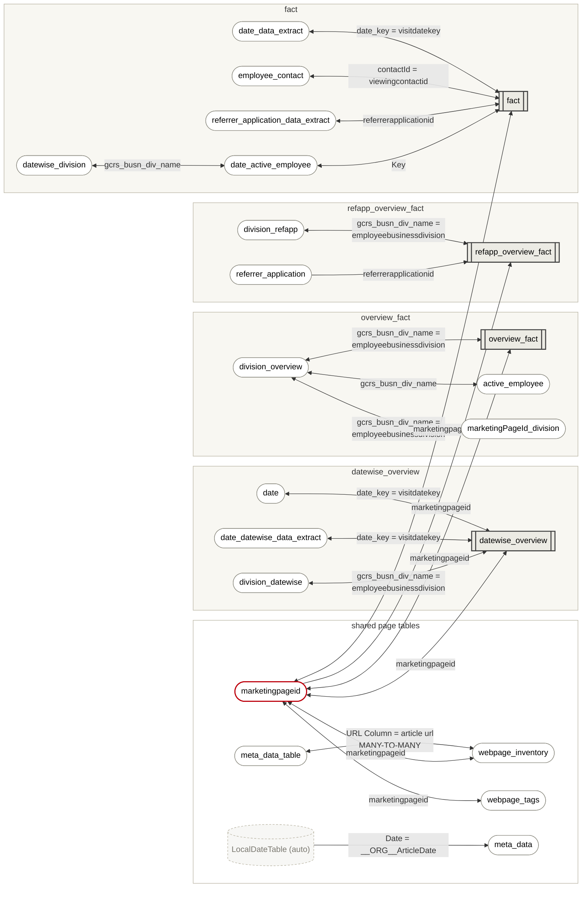

# Intranet Analytics v2.0

| | |
|---|---|
| Workspace | IMEP-UAT |
| Snapshot | 2026-10-16 |
| Source | `INFO.VIEW.*` metadata export (relationships, columns, measures), photographed |
| Access | Read only — measure DAX and source queries are hidden, see [Open questions](#open-questions) |
| Sensitivity label | Internal |

Object names that contain the organisation name are written as `__ORG__`, so the
repository stays free of it.

## Executive summary

Intranet Analytics v2.0 reports how the intranet is used: unique visitors, views, visits,
likes, comments and time spent — per page, site, division, region and referring
application, over rolling 7/14/21/28-day windows and "ty" (most likely *this year*), plus
the share of active employees reached.

It has **31 tables, ~455 columns, 115 measures and 21 relationships**. Underneath, it is
four separate mini-models — one per fact table — each with its own copy of the date,
division and referrer tables, stitched together through a single page table
(`marketingpageid`) whose relationships filter in **both directions**.

That design works, but it carries three real risks:

1. **Numbers leak between visuals.** A filter meant for one fact table travels through
   the shared page table into the others (issue 1).
2. **Slicers don't reach every visual.** Each fact table answers to a different date
   table, so one date slicer filters some visuals and silently ignores others (issue 2).
3. **The model is large and rigid.** ~165 columns hold pre-calculated rolling-window
   unique visitors; every new window or grain means new columns upstream (issue 3).

**Recommended order:** one shared date and division table → single-direction filters →
test whether the rolling windows can become measures over `fact` → clean up the article
metadata table and leftovers. Structural findings are confirmed from the metadata;
anything about calculations waits for the DAX.

## At a glance

| Role | Tables |
|---|---|
| Fact (numbers) | `fact`, `overview_fact`, `datewise_overview`, `refapp_overview_fact` |
| Date | `date`, `date_data_extract`, `date_datewise_data_extract` (+ 2 hidden auto-date tables) |
| Division | `division_overview`, `division_datewise`, `datewise_division`, `division_refapp`, `marketingPageId_division` |
| Page / article | `marketingpageid`, `webpage_inventory`, `webpage_tags`, `meta_data`, `meta_data_table` |
| People | `employee_contact`, `active_employee`, `date_active_employee` |
| Referrer | `referrer_application`, `referrer_application_data_extract` |
| Measures only | `Article Measures` (33), `Intranet Measures` (50), `Intranet Page Level Measures` (3) |
| Helpers, not linked | `Dimension`, `Measure` (field parameters), `Refreshtime`, `weeks` |

## How the tables connect

Arrows show the direction a filter travels: from the lookup table (one row per key) to
the fact table (many rows per key). **Double-headed arrows filter both ways.** All
relationships are one-to-many and active unless the label says otherwise.



**Legend:** grey boxes = fact tables · white = lookup tables · red outline = the shared
page hub · dashed = hidden auto-date table. Each shaded group is one fact table with its
own date, division and referrer tables; `marketingpageid` is the only thing they share.

### Relationships

| # | Many side (filtered) | One side (filters) | Key | Direction |
|---|---|---|---|---|
| 1 | `active_employee` | `division_overview` | `gcrs_busn_div_name` | both |
| 2 | `date_active_employee` | `datewise_division` | `gcrs_busn_div_name` | both |
| 3 | `datewise_overview` | `division_datewise` | `employeebusinessdivision` → `gcrs_busn_div_name` | both |
| 4 | `datewise_overview` | `marketingpageid` | `marketingpageid` | both |
| 5 | `datewise_overview` | `date` | `visitdatekey` → `date_key` | both |
| 6 | `datewise_overview` | `date_datewise_data_extract` | `visitdatekey` → `date_key` | both |
| 7 | `fact` | `date_active_employee` | `Key` → `Key` | both |
| 8 | `fact` | `marketingpageid` | `marketingpageid` | both |
| 9 | `fact` | `referrer_application_data_extract` | `referrerapplicationid` | both |
| 10 | `fact` | `employee_contact` | `viewingcontactid` → `contactId` | both |
| 11 | `fact` | `date_data_extract` | `visitdatekey` → `date_key` | both |
| 12 | `marketingPageId_division` | `division_overview` | `employeebusinessdivision` → `gcrs_busn_div_name` | both |
| 13 | `meta_data` | `LocalDateTable_086eb602…` | `__ORG__ArticleDate` → `Date` | single |
| 14 | `meta_data_table` | `webpage_inventory` | `URL Column` → `article url` | **both, many-to-many** |
| 15 | `overview_fact` | `division_overview` | `employeebusinessdivision` → `gcrs_busn_div_name` | both |
| 16 | `overview_fact` | `marketingpageid` | `marketingpageid` | both |
| 17 | `refapp_overview_fact` | `division_refapp` | `employeebusinessdivision` → `gcrs_busn_div_name` | both |
| 18 | `refapp_overview_fact` | `marketingpageid` | `marketingpageid` | single |
| 19 | `refapp_overview_fact` | `referrer_application` | `referrerapplicationid` | single |
| 20 | `webpage_inventory` | `marketingpageid` | `marketingpageid` | both |
| 21 | `webpage_tags` | `marketingpageid` | `marketingpageid` | both |

18 of 21 relationships filter both ways. All 21 are active.

### Fact tables

| Table | Columns | What a row most likely is | Numbers it holds |
|---|---|---|---|
| `fact` | 12 | one person × page × day | `views`, `visits`, `comments`, `durationsum`, `durationavg`, `flag`; plus `viewingcontactid`, `referrerapplicationid`, `Key` |
| `overview_fact` | 77 | one page × division × region | unique visitors, views, visits, likes, comments — at page, site, division and region level, each for 7/14/21/28 days, *ty* and all time |
| `datewise_overview` | 32 | one page × division × day | unique visitors for page, site and division by day and rolling window; daily views, visits, likes, comments |
| `refapp_overview_fact` | 56 | one page × division × referring app | unique visitors and visits by referrer, site and division, rolling windows |

"What a row is" is inferred from the column names; the source queries would confirm it.

## Issues

Each issue states how sure we are: **Confirmed** = visible in the metadata,
**Likely** = follows from the structure but depends on report or DAX details,
**Open** = needs the DAX or source queries.

### 1. Filters leak between fact tables through `marketingpageid` — Confirmed (structure)

Every fact table and both page tables are linked to `marketingpageid` in both
directions. A filter on any one of them therefore travels *up* into `marketingpageid`
and back *down* into all the others.

**Example.** A report page has a date slicer from `date` set to *last 7 days*, and a
card showing total views from `fact`.


`fact` is not linked to `date`, so its dates are never filtered. But the slicer still
shrinks the list of pages. The card ends up showing *all-time views of pages that happened
to be visited last week*. That number looks plausible but answers no real question.

**Fix.** Set the relationships to single direction (lookup → fact). Where a visual
genuinely needs the reverse direction, switch it on for that one measure with
`CROSSFILTER(…, BOTH)`.

### 2. Each fact table has its own date, division and referrer table — Confirmed (structure)

| Concept | Copies | Used by |
|---|---|---|
| Date | `date`, `date_datewise_data_extract` | `datewise_overview` |
| | `date_data_extract` | `fact` |
| | *(none)* | `overview_fact`, `refapp_overview_fact` |
| Division | `division_overview` | `overview_fact`, `active_employee`, `marketingPageId_division` |
| | `division_datewise` | `datewise_overview` |
| | `division_refapp` | `refapp_overview_fact` |
| | `datewise_division` | `date_active_employee` |
| Referrer | `referrer_application_data_extract` | `fact` |
| | `referrer_application` | `refapp_overview_fact` |

The three date tables have identical columns. The four division tables each hold a single
column, `gcrs_busn_div_name`.

**Example.** A page shows a *views over time* chart (`fact`) and a *unique visitors per
day* chart (`datewise_overview`). The user picks *September* in a month slicer built on
`date`. The visitors chart switches to September; the views chart doesn't move, because
`fact` listens to `date_data_extract`, not `date`. Both charts sit side by side and seem
to disagree. (Through issue 1, the views chart *does* change slightly, by pages, which
makes it even harder to spot.)

**Fix.** One shared date table and one shared division table, linked to every fact table.
The same for referrer. That removes about six tables.

### 3. Rolling windows are pre-calculated into ~165 columns — Confirmed (structure), fix Open

`overview_fact` (77), `refapp_overview_fact` (56) and `datewise_overview` (32) store unique
visitors for every combination of level (page, site, division, region, referrer) and window
(7, 14, 21, 28 days, ty, all time).

**Why someone built it this way.** Unique visitors can't simply be added up:

> Anna reads page A and page B on Monday. Page A has 1 unique visitor, page B has 1.
> Adding them gives 2, but the site had **1** unique visitor — Anna.

So every level needs its own count, and the upstream job pre-calculated all of them.

**Why it hurts.**
- Every new window (say 90 days) or level means new columns in Databricks *and* new
  measures in Power BI.
- If the windows are counted back from the refresh date, they ignore the date slicer:
  *"last 7 days"* always means the 7 days before the last refresh, even when the user
  picked August. This depends on the DAX and source queries — **Open**.

**Fix to test.** `fact` already has one row per person, page and day. A distinct count of
`viewingcontactid` over a date window answers every level and window from one table:

```dax
Unique visitors (7d) =
VAR _end = MAX ( 'Date'[Date] )
RETURN
    CALCULATE (
        DISTINCTCOUNT ( fact[viewingcontactid] ),
        DATESINPERIOD ( 'Date'[Date], _end, -7, DAY )
    )
```

Whether this is fast enough depends on how many rows `fact` has. That needs one test on the
real model. Keep a pre-calculated table only for the combinations that turn out too slow.

### 4. Article metadata is joined on URL text, many-to-many, both ways — Confirmed (structure)

`meta_data_table[URL Column]` ↔ `webpage_inventory[article url]`.

**Example.** The article list stores
`…/news/annual-results.aspx`; the page inventory stores `…/news/annual-results.aspx/`
(trailing slash) or with a `?web=1` suffix. The two never match, and the article loses its
author, audience and category in every report — without an error. And because the link
filters both ways, selecting an *Author* also filters `webpage_inventory`, and through
issue 1 every fact table.

**Fix.** Join on a page ID (`marketingpageid` / `sourcesystempageid`) instead of a URL. If
the URL is the only common key, normalise it upstream (lower case, no trailing slash, no
query string) and make the link one-directional.

### 5. `meta_data` is a raw SharePoint list with 45 "target organisation" columns — Confirmed

`meta_data` has ~88 columns, among them `__ORG__TargetOrganization` and
`__ORG__TargetOrganization 2` … `45`, `__ORG__Channels` 1–4, `Author` 1–4,
`__ORG__TargetRegion` 1–3 and `__ORG__Topic` 1–2. The list's multi-value fields were
split into one column per value.

**Example.** *"How many articles targeted Group Functions?"* Group Functions can sit in any
of the 45 columns. A filter on the first column misses every article where it was the
seventh target.

**Also:** `meta_data_table` holds a subset of the same columns, and `meta_data` is not
linked to anything except its own auto-date table. One of the two is probably unused.

**Fix.** Turn each multi-value field into a small bridge table (article × target
organisation, article × channel, …) and drop the numbered columns. Keep one metadata table.

### 6. Auto date/time is switched on — Confirmed

`LocalDateTable_086eb602…` and `DateTableTemplate_14338259…` are hidden tables Power BI
creates on its own for date columns.

**Example.** `meta_data[__ORG__ArticleDate]` has its own private calendar. A slicer on the
main date table can never filter articles by publish date. Each such table also adds size.

**Fix.** *File › Options › Current file › Data load › Auto date/time* off. Link the date
columns that matter to the shared date table instead.

### 7. Duplicate employee tables and a text key into them — Likely

`active_employee` and `date_active_employee` have almost the same columns (`avgcount`,
`count`, `D_datekey`, `datekey`, `gcrs_busn_div_name`, `Key`, `total_emp_id`,
`year-month`). `fact[Key]` → `date_active_employee[Key]` is a text column. Given
`D_datekey`, `datekey` and the division column, it is probably *date + division* glued
together.

**Example.** If one side writes `20260915|Group Functions` and the other
`2026-09-15|Group Functions`, nothing matches and *% of active employees reached* goes
blank for that day. Text keys are also slower to join than integer keys.

**Fix.** Keep one employee-count table, keyed by date and division through the shared date
and division tables (issue 2), not by a glued text key.

### 8. Leftovers and measure housekeeping — Confirmed

- Test columns: `active_employee[test1_date_employees]`,
  `date_active_employee[test_date_employees]`.
- Copied columns: `webpage_inventory[theme - Copy]`, `[topic - Copy]`,
  `meta_data[__ORG__PromoteVideo - Copy]`, `meta_data_table[__ORG__PromoteVideo - Copy]`.
- Trial measures: `overview_fact[trial]`, `Intranet Measures[total pages trial]`,
  `Article Measures[Avg_TY chekc]`, `date[midate]` (probably *min date*).
- Measures sit on 9 data tables besides the 3 measure tables, e.g. `date[maxdate]`,
  `webpage_inventory[sites]`, `fact[Unique visitors]`.
- `x`-prefixed measures (`xViews`, `xVisits`, `xcomments`, `xdivision`, `xxtopic`, …) look
  like helpers. Whether any visual still uses them can only be told from the report.

**Fix.** Delete what no visual uses, after checking (Tabular Editor's *Best Practice
Analyzer* or the report's field list). Move remaining measures into the measure tables.

## Open questions

| Question | Needed for | How to get it |
|---|---|---|
| Measure DAX | Issues 3, 7, 8 | Owner's `.pbix`, or write access to the model |
| Source query per table (`partition` in TMDL view) | Issue 3; mapping to Databricks bronze/silver/gold | Same |
| Row count of `fact` | Issue 3 (speed of distinct count) | `EVALUATE ROW("rows", COUNTROWS(fact))` |
| Storage mode per table (Import/DirectQuery) | General | `EVALUATE INFO.VIEW.TABLES()` |
| Row-level security roles | General | Model owner |
| Which report pages use which tables | Issues 1, 2 | Report file |
