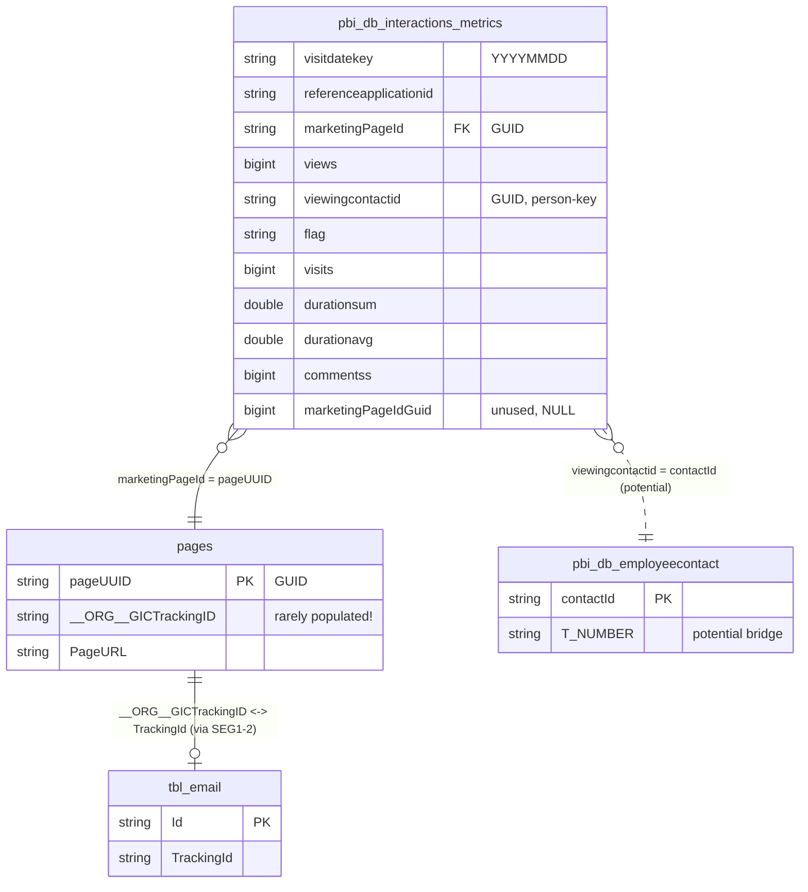

# `sharepoint_gold.pbi_db_interactions_metrics`

> **Master interaction fact for SharePoint.** Tens of millions of rows, 11 columns. Central table for pageview, visit, duration and comment metrics on page × date × contact grain. **Carries no direct TrackingID** — cross-channel attribution always runs via `marketingPageId -> pageUUID -> __ORG__GICTrackingID` through `sharepoint_bronze.pages`.

| | |
|---|---|
| **Layer** | Gold (consumption) |
| **Source system** | SharePoint Analytics (aggregated from `sharepoint_silver`) |
| **Grain** | 1 row per `marketingPageId × visitdatekey × viewingcontactid × referenceapplicationid` |
| **Primary key** | Composite (marketingPageId + visitdatekey + viewingcontactid + referenceapplicationid) |
| **Cross-channel key** | **none directly** — only via FK chain `marketingPageId -> pageUUID -> __ORG__GICTrackingID` |
| **Tier** | **Tier 0 — atomic interaction fact** |
| **Write pattern** | Notebook-based Full Rebuild (Spark 3.2.1), no managed pipeline |
| **Approx row count** | **Tens of millions**, tens of thousands of distinct pages |
| **Physical storage** | External Delta, ADLS path `abfss://gold@<gold-acc>/.../employee_analytics/pbi_db_interactions_metrics`, **no partitioning** -> full-scan risk |

---

## Neighborhood — FK chain to the cross-channel join



---

## Key Columns

| Column | Type | Sample | Role |
|---|---|---|---|
| `visitdatekey` | string | `20230421` | **Day key** in `YYYYMMDD` format. Grain-defining. |
| `referenceapplicationid` | string | `2` | Application reference (which system) |
| `marketingPageId` | string (GUID) | `00000000-0000-4000-8000-000000000001` | **FK** -> `pages.pageUUID`. The only cross-channel path. |
| `views` | bigint | `1` | Pageview count |
| `viewingcontactid` | string (GUID) | `00000000-0000…` | **Person key** — not TNumber, but a bridge via `pbi_db_employeecontact` is possible |
| `flag` | string | `1` | Meaning unclear — follow-up |
| `visits` | bigint | `1` | Distinct visit count (with dedup) |
| `durationsum` | double | `30.0` | Time on page (seconds, summed) |
| `durationavg` | double | `30.0` | Average duration |
| `commentss` | bigint | `0` | Comment count (typo in column name — **`commentss`** with double s) |
| `marketingPageIdGuid` | bigint | `NULL` | Always NULL — presumably a legacy column |

CDM validation confirmed the mapping: `sourceName: mailync_marketingpageid`, `dataFormat: Guid`.

---

## Primary joins

### -> `sharepoint_bronze.pages` (N:1) — the standard lookup

```sql
SELECT m.*, p.__ORG__GICTrackingID, p.PageURL, p.SiteName
FROM   sharepoint_gold.pbi_db_interactions_metrics m
LEFT JOIN sharepoint_bronze.pages p ON p.pageUUID = m.marketingPageId
```

-> **LEFT JOIN**, otherwise you lose the vast majority of rows without a set TrackingID.

### -> Pack-level cross-channel funnel

```sql
SELECT array_join(slice(split(UPPER(p.__ORG__GICTrackingID), '-'), 1, 2), '-') AS tracking_pack_id,
       SUM(m.views)                  AS total_views,
       COUNT(DISTINCT m.viewingcontactid) AS unique_viewers,
       SUM(m.durationsum)            AS total_duration_sec
FROM   sharepoint_gold.pbi_db_interactions_metrics m
JOIN   sharepoint_bronze.pages p ON p.pageUUID = m.marketingPageId
WHERE  p.__ORG__GICTrackingID IS NOT NULL          -- mandatory filter
  AND  m.visitdatekey >= '20250101'            -- default time window from 2025
GROUP BY 1
```

### -> Potential SharePoint person bridge

```sql
-- UNVERIFIED — hypothesized from earlier findings, not yet tested
SELECT m.*, ec.T_NUMBER
FROM   sharepoint_gold.pbi_db_interactions_metrics m
LEFT JOIN sharepoint_gold.pbi_db_employeecontact ec ON ec.contactId = m.viewingcontactid
```

-> If this works, we would have a TNumber for SharePoint views. **Not yet validated.**

---

## Quality caveats

- **⚠️ No direct TrackingID** — if someone looks directly for `WHERE ...TrackingId = ...`, they won't find it. Always go via `pages.__ORG__GICTrackingID`.
- **Low-coverage blocker** (critical!): only a small minority of pages (low single-digit percent) have `__ORG__GICTrackingID`. Meaning: of the tens of millions of interaction rows, **only a few million are pack-attributable** (low single-digit percent). The vast remainder is "untracked intranet activity". The dashboard **must** label this section explicitly.
- **`viewingcontactid` != TNumber** — SharePoint-native person ID (GUID). If person-level attribution is needed, it runs via `pbi_db_employeecontact` (still to validate).
- **Column typo**: `commentss` (with double s). Don't fix it — you'd break every query.
- **`marketingPageIdGuid`** is always NULL — ignore.
- **Grain anomaly**: a page × date × contact may in theory have multiple rows (due to `referenceapplicationid` variations) — for page-date grain rollup use `GROUP BY marketingPageId, visitdatekey` and `SUM(views)`.
- **`visitdatekey` formatted as a string** — for time-range filters parse via `CAST(visitdatekey AS date)` or string compare `visitdatekey >= '20250101'`.

---

## Lineage

```
sharepoint_bronze.customevents       +
sharepoint_bronze.pageviews          +--> sharepoint_silver.webpagevisited  --> sharepoint_gold.pbi_db_interactions_metrics
sharepoint_bronze.pagevisited_*      +                                              (metric aggregation per page × date × contact)
```

-> Unlike iMEP email, here silver **does** sit in between (confirmed). SharePoint uses the full medallion pattern.

---

## Sister tables in the same schema

For **different grain requirements** there are more specialized gold tables:

| Table | Rows | Cols | When to use |
|---|---|---|---|
| **`pbi_db_interactions_metrics`** | Tens of millions | 11 | Default — everything in one table |
| `pbi_db_pageviewed_metric` | Tens of millions | 5 | View counts only, fast aggregation |
| `pbi_db_pagevisited_metric` | Tens of millions | 9 | Visit-oriented (with dedup) |
| `pbi_db_datewise_overview_fact_tbl` | Millions | 31 | Pre-aggregated page × date × division with rolling windows (7/14/21/28d) |
| `pbi_db_90_days_interactions_metric` | Millions | 11 | 90-day window, smaller, faster |

Rule of thumb: for ad-hoc queries use `interactions_metrics`; for dashboards with time rollups use `datewise_overview_fact_tbl`; for pure count queries use `pageviewed_metric`.

---

## References

- [pages.md](../sharepoint/pages.md) — the dimension lookup for TrackingID
- [join_strategy_contract.md](../../joins/join_strategy_contract.md) — cross-channel join rules

---

## Sources

Genie sessions backing the statements on this page: [Q17](../../sources.md#q17), [Q22](../../sources.md#q22), [Q26](../../sources.md#q26), [Q29](../../sources.md#q29), [Q30](../../sources.md#q30). See [sources.md](../../sources.md) for the full directory.
